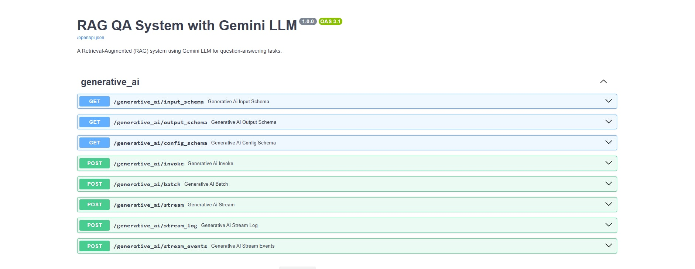
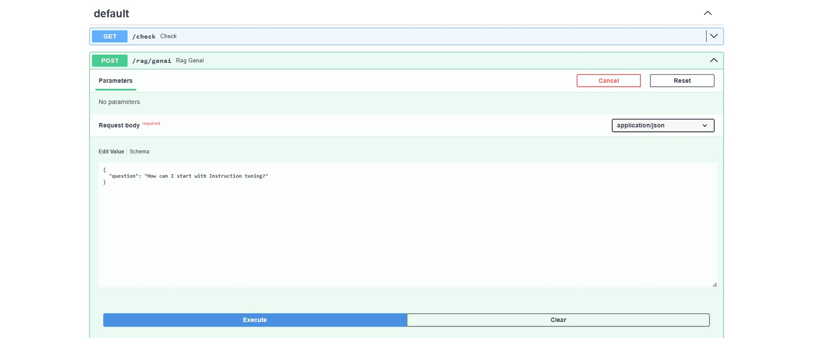
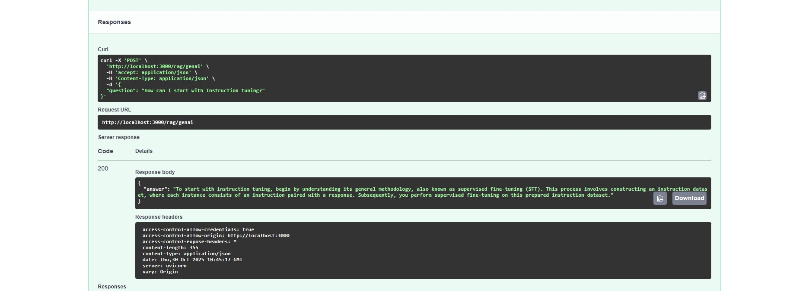

# Contextual RAG API

Contextual RAG API is a document question-answering service built with Python, LangChain, FastAPI, LangServe, and Google Gemini. It indexes a local PDF collection, retrieves relevant passages for each question, and uses those passages to produce a concise answer.

## Features

- FastAPI application with health-check and question-answering endpoints
- LangServe routes and an interactive playground
- PDF loading and configurable text chunking
- Hugging Face sentence-transformer embeddings
- Persistent Chroma vector storage, with FAISS support in the vector-store abstraction
- Google Gemini generation through LangChain
- Modular components for loading, indexing, retrieval, prompting, and serving

## Architecture

1. `Loader` reads PDFs from `src/data_source/gen_ai/` and splits their text into chunks.
2. `VectorDB` embeds the chunks with `sentence-transformers/all-MiniLM-L6-v2` and stores them in Chroma.
3. The retriever selects the ten most similar chunks for each question.
4. The RAG chain passes the retrieved context and question to Gemini.
5. FastAPI exposes the chain through a standard JSON endpoint and LangServe routes.

The first application start creates the persistent vector index in `src/data_source/vector_db/`. Later starts reuse that index. Delete the index and restart the application after changing the source documents so that they are re-indexed.

## Requirements

- Python 3.10 or newer
- A Google Gemini API key

## Installation

```bash
git clone https://github.com/MarieHasson/contextual-rag-api.git
cd contextual-rag-api

python -m venv .venv
source .venv/bin/activate
pip install -r requirements.txt
```

On Windows PowerShell, activate the environment with:

```powershell
.venv\Scripts\Activate.ps1
```

## Configuration

Create a `.env` file in the repository root:

```dotenv
GEMINI_API_KEY=your_google_gemini_api_key
```

The application uses `gemini-2.5-flash` by default. The `.env` file and generated vector database are excluded from Git.

## Add documents

Place one or more PDF files in `src/data_source/gen_ai/`. A sample research-paper corpus is included. The optional downloader can retrieve the same example papers when run from that directory:

```bash
cd src/data_source/gen_ai
python download.py
cd ../../..
```

## Run the API

Start the server from the repository root:

```bash
PYTHONPATH=src uvicorn src.app:app --host 0.0.0.0 --port 3000 --reload
```

Available interfaces:

- Health check: `GET http://localhost:3000/check`
- OpenAPI documentation: `http://localhost:3000/docs`
- LangServe playground: `http://localhost:3000/generative_ai/playground/`
- Question answering: `POST http://localhost:3000/rag/genai`

Example request:

```bash
curl --request POST http://localhost:3000/rag/genai \
  --header "Content-Type: application/json" \
  --data '{"question":"What is instruction tuning?"}'
```

Example response:

```json
{
  "answer": "Instruction tuning adapts a language model using examples that pair instructions with desired responses."
}
```

## API preview







## Project structure

```text
contextual-rag-api/
├── assert/                         # API screenshots
├── data/                           # Notebook sample data
├── notebooks/                      # Exploration and prototyping notebooks
├── src/
│   ├── app.py                      # FastAPI application
│   ├── data_source/
│   │   ├── gen_ai/                 # PDF corpus and download helper
│   │   └── vector_db/              # Generated persistent index (ignored)
│   └── rag/
│       ├── base/
│       │   └── llm_models.py       # Gemini model adapter
│       └── rag_system/
│           ├── file_loader.py      # PDF loading and chunking
│           ├── main.py             # RAG-chain assembly
│           ├── rag_offline.py      # Retrieval and generation chain
│           ├── rag_utils.py        # Response parsing helper
│           └── vectorstore.py      # Chroma and FAISS abstraction
├── .gitignore
├── README.md
└── requirements.txt
```

## Notes

- The API builds the chain during application startup, so the Gemini key and PDF corpus must be available before the server starts.
- CORS currently allows all origins. Restrict this setting before exposing the service publicly.
- The bundled PDFs are sample retrieval content; replace or supplement them with documents appropriate for your use case.
